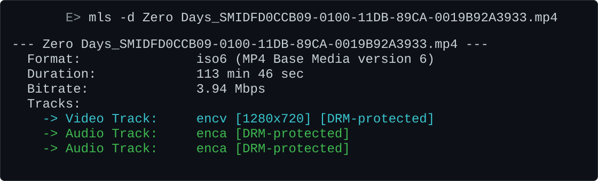

# mls

**mls** (*media list*) is a lightweight .NET console utility that inspects media container files and prints a concise summary of format, duration, bitrate, and tracks — similar to `ls`, but for video files.

It parses container metadata only (no full decode), so it stays fast even on large files.

## Supported formats

| Extension | Container | What is reported |
|-----------|-----------|------------------|
| `.mp4` | ISO BMFF / MP4 (including fragmented MP4) | Brand, duration, bitrate, tracks, codecs, resolution, DRM flags |
| `.mkv` | Matroska / WebM | DocType, duration, bitrate, tracks, codecs, resolution, language |
| `.m2ts` | Blu-ray MPEG-TS (192-byte packets) | Duration (via PCR), bitrate, tracks, codecs, video resolution |

## Requirements

- [.NET 10 SDK](https://dotnet.microsoft.com/download) (or a runtime that can run `net10.0` apps)
- Windows is the primary target (the optional `--cold` cache eviction uses Windows-specific file flags)

## Build

```bash
dotnet build
```

Or publish a standalone binary:

```bash
dotnet publish -c Release -o ./publish
```

## Usage

```text
mls [-v] [-d] [-s] [--cold] <path_to_file_or_wildcard>
```

| Flag | Description |
|------|-------------|
| `-v`, `--verbose` | For MP4, print structural box names/sizes while parsing |
| `-d`, `--duration` | Include media duration in the summary (bitrate is always shown when known) |
| `-s`, `--subtitles` | Include subtitle tracks (hidden by default) |
| `--cold` | Evict the file from the Windows standby cache before parsing (useful for cold-read timing / I/O experiments) |

Paths may be a single file or a shell-style wildcard (e.g. `*.mp4`).

### Examples

```bash
# Single file
mls movie.mp4

# All MKV files in the current directory
mls *.mkv

# Include duration
mls -d movie.mp4

# Include subtitle tracks
mls -s movie.mp4

# Verbose MP4 box walk
mls -v clip.mp4

# Cold-cache parse (Windows)
mls --cold large.m2ts
```

### Example output



## What each parser does

### MP4 (`Mp4Parser`)

- Locates the `moov` atom (supports 32- and 64-bit sizes)
- Reads duration from `mvhd`, with fallback to fragmented duration in `mehd` / `mvex`
- Walks tracks via `trak` → `tkhd` (display size fallback), `hdlr` (type), sample entries (`avc1`, `hev1`, `hvc1`, `dvh1`, `mp4a`, encrypted `encv`/`enca`)
- Prefers VisualSampleEntry coded width/height over `tkhd` display size when available
- Maps sample-entry fourccs (`avc1`, `hev1`, `mp4a`, …) to the same labels as MKV/M2TS; `encv`/`enca` stay as-is with a DRM flag
- Flags DRM-protected tracks when encrypted sample entries are present
- Computes average bitrate from file size ÷ duration (duration line is opt-in via `-d`)

### Matroska / WebM (`MkvParser`)

- Validates the EBML header and DocType (`matroska` vs `webm`)
- Parses `Info` (timecode scale, duration) and `Tracks` only — stops at the first `Cluster` to minimize I/O
- Maps CodecIDs (and VFW FOURCC / ACM tags) to the same human-readable labels used for M2TS
- Reports track language when present

### M2TS (`M2tsParser`)

- Scans 192-byte Blu-ray transport packets
- Resolves PAT → PMT for the program map and elementary stream types
- Estimates duration from first/last PCR on the PCR PID
- Extracts video resolution from elementary stream headers (MPEG-2, VC-1, H.264 SPS, H.265 SPS)
- Hides subtitle tracks by default in the summary (parser still collects them)

## Project layout

```text
mls/
├── Program.cs        # CLI entry point, file discovery, dispatch by extension
├── Mp4Parser.cs      # ISO BMFF / MP4 box parser
├── MkvParser.cs      # Matroska / WebM EBML parser
├── M2tsParser.cs     # Blu-ray M2TS / MPEG-TS parser (+ BitReader for SPS)
├── ParseContext.cs   # Shared parse state (duration, tracks, etc.)
├── TrackInfo.cs      # Per-track metadata model
├── Mls.csproj        # .NET 10 console project
└── Mls.slnx          # Solution file
```

## Exit codes

| Code | Meaning |
|------|---------|
| `0` | Success |
| `1` | No arguments / usage printed |
| `2` | No path provided after flags |
| `3` | Wildcard matched zero files |
| `4` | Specified file does not exist |
| `5` | I/O or path-related error during discovery |

## License

This project is licensed under the [MIT License](LICENSE).
